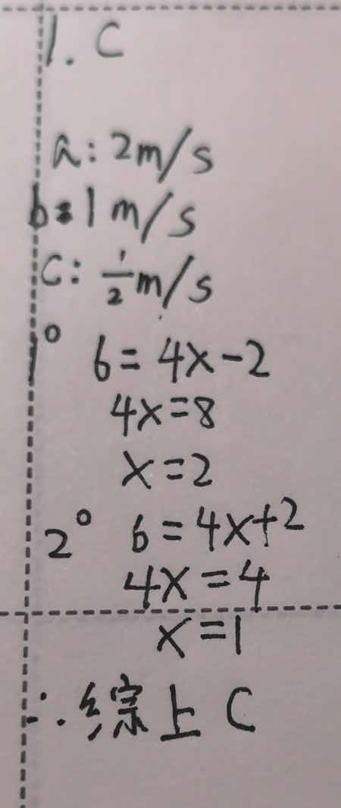
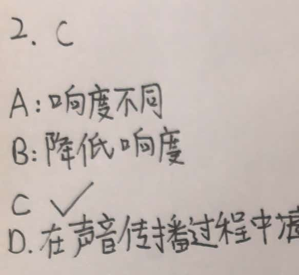
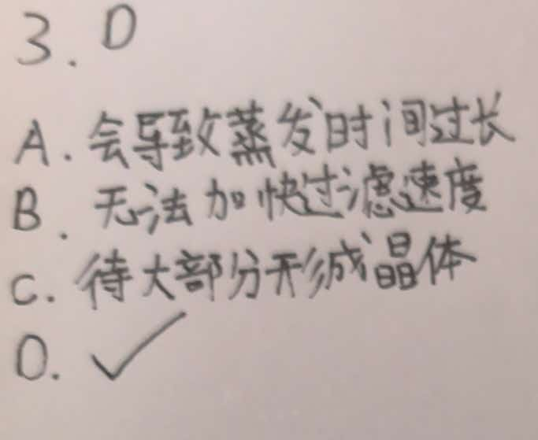

1.甲、乙两物体先后从同一地点沿同一方向做匀速直线运动，甲比乙先出发 2s。当甲运动 6s 时，甲通过的路程为 6m，此时甲、乙之间的距离为 2m。若乙的 s-t 图线是图中 a、b、c 三条图线中的一条（a：4s 走 8m；b：4s 走 4m；c：4s 走 2m），则（ ）
A. 乙的图线一定是 a
B. 乙的图线一定是 c
C. 乙的图线可能是 b
D. 条件不足，无法判断

**2. 声现象**
关于声音，下列说法正确的是（　　）
A. 用大小不同的力敲同一音叉，发出声音的音调不同
B. "公共场所不要大声喧哗"是要求降低声音的音调
C. 蝙蝠利用超声波探测障碍物，说明声音可以传递信息
D. 在道路两旁植树是在声源处减弱噪声

**3. 物态变化（粗盐提纯实验）**
在"粗盐中难溶性杂质的去除"实验中，下列操作或说法正确的是（　　）
A. 溶解粗盐时，加入的水越多越好，以保证粗盐完全溶解
B. 过滤时，为加快过滤速度，可用玻璃棒在漏斗内搅拌
C. 蒸发时，待蒸发皿中水分完全蒸干后再停止加热
D. 实验中玻璃棒在溶解、过滤、蒸发三个步骤中的作用各不相同

